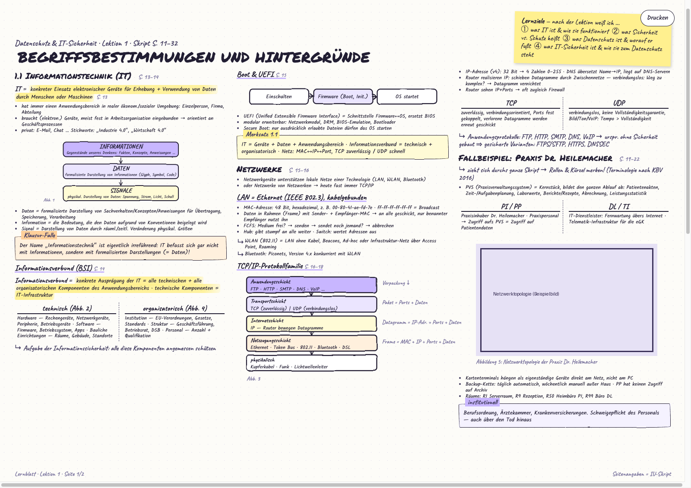

# IU Kapitel-Assistent

Erzeugt aus einem oder mehreren Kapitel-PDFs eines IU-Studienskripts entweder eine Wiedereinstiegs-Zusammenfassung oder ein Anki-Karteikarten-Deck.

Kein eigener API-Key nötig: Das Tool kopiert einen fertigen Prompt in die Zwischenablage, du fügst ihn in ein beliebiges KI-Chat-Tool ein (ChatGPT, Claude, Gemini, ...), kopierst die Antwort zurück in die Zwischenablage und drückst Enter. Das funktioniert mit jedem bestehenden Pro-Abo, ohne separate API-Kosten.

Passt als Ergänzung zu [iu-kapitel-splitter](https://github.com/GitHubQerim/iu-kapitel-splitter), das ein IU-Course-Book zunächst in einzelne Kapitel-PDFs zerlegt — kann aber auch mit jedem anderen PDF genutzt werden, das eine einzelne Lektion/ein einzelnes Kapitel enthält.

## Installation

```bash
python3 -m pip install -r requirements.txt
```

## Nutzung

```bash
# Zusammenfassung (Markdown + HTML, inkl. Bildern aus dem Kapitel)
python3 kapitel_assistent.py summary kapitel_1_einfuehrung.pdf --out zusammenfassung.md

# Kurz statt ausführlich, ohne Bilder, mit zusätzlichem Glossar-Abschnitt
python3 kapitel_assistent.py summary kapitel_1_einfuehrung.pdf --out zusammenfassung.md \
  --detail kurz --no-images --glossar

# Anki-Karteikarten (.apkg, inkl. Bild-Karten für Diagramme/Grafiken)
python3 kapitel_assistent.py flashcards kapitel_1_einfuehrung.pdf --out karteikarten.apkg
```

Bei der Zusammenfassung lässt sich der Detailgrad steuern (`--detail kurz|ausfuehrlich`, Standard: ausführlich), ob Abbildungen aus dem PDF extrahiert werden sollen (`--images`/`--no-images`, Standard: an) und ob am Ende ein zusätzlicher Glossar-Abschnitt mit Fachbegriffs-Erklärungen angefordert wird (`--glossar`). Jede Zusammenfassung endet außerdem automatisch mit einer "Prüfungs-Merkliste in Kürze" als eigener, beim Drucken auf einer neuen Seite beginnender Abschnitt.

Ablauf: Prompt wird automatisch in die Zwischenablage kopiert → in ein KI-Chat-Tool einfügen → Antwort kopieren → im Terminal Enter drücken. Das Tool liest die Antwort aus der Zwischenablage und baut daraus die Ausgabedatei.

Mehrere PDFs als Input sind möglich, um Kapitel aus verschiedenen Quellen zu einer Zusammenfassung bzw. einem Deck zu kombinieren. Seiten mit eingebetteten Bildern (Diagramme, Grafiken) werden automatisch extrahiert. Bei Karteikarten bittet der Prompt die KI, zu jeder erkannten Abbildung eine echte Verständnisfrage zu schreiben (nicht nur die Bildunterschrift als Frage) — das passende Bild wird dann automatisch an genau diese Karte gehängt. Nur Abbildungen, zu denen keine Karte erstellt wurde, bekommen als Fallback eine einfache Bild-Karte, damit nichts verloren geht. Der Anki-Deck-Name lässt sich über `--deck` setzen (z. B. `--deck "DLBMIUID01-01::Kapitel 8"`, mit `::` für verschachtelte Decks in Anki); ohne Angabe wird der Ordnername verwendet.

Falls die Antwort aus dem Chat-Tool kein valides JSON ist (z. B. weil ein Codeblock oder ein einleitender Satz mitkopiert wurde), bricht der Befehl nicht ab: der Fehler wird angezeigt, der Prompt bleibt in der Zwischenablage, und man kann die Antwort korrigieren und einfach erneut Enter drücken.

Damit bei mehreren Kapiteln nichts flach im Modulordner verstreut liegt, wird beim Speichern automatisch ein nach der Ausgabedatei benannter Unterordner angelegt und die Quell-PDF(s) hineinverschoben — Zusammenfassung/Deck, Bilder und PDF landen so gemeinsam an einem Ort.

### Zusammenfassung 2.0 (Sketch-Lernblatt)

```bash
python3 kapitel_assistent.py summary kapitel_1_einfuehrung.pdf --out lernblatt.html --mode sketch
```



Statt Markdown erzeugt `--mode sketch` ein dichtes, handschriftlich wirkendes Lernblatt im
A3-Querformat (3 Spalten, Handschrift-Fonts, handgezeichnete SVG-Skizzen statt reiner Fotos,
Merkliste + Glossar als Fußleiste). Die KI liefert dabei **nur strukturierten Inhalt als
JSON** (siehe `schema/sketch_summary.schema.json`) — das komplette Layout, alle Farben und
alle Zeichnungen entstehen lokal aus Code (`render/sketch/`), das kostet pro Kapitel keine
zusätzlichen Tokens.

Einschränkungen gegenüber dem klassischen Modus:
- **Nur ein PDF pro Aufruf.** Die echten Skript-Seitenzahlen (`S. 13–14` statt PDF-Seite 3)
  werden aus der Fußzeile jeder PDF-Seite geparst und sind PDF-lokal — bei mehreren PDFs
  würden sich die Seitenzahlen überschneiden. Wird die Fußzeile auf der ersten Seite nicht
  erkannt, greift `--start-page <n>` als Fallback.
- Der `--images`/`--no-images`-Schalter (bzw. der „Bilder"-Chip in der GUI) bedeutet hier:
  **an** = die KI entscheidet pro Abbildung, ob eine nachgezeichnete Skizze oder das echte
  Bild sinnvoller ist; **aus** = immer das echte extrahierte Bild verwenden, keine Skizzen.
- `--glossar` entfällt: Glossar und Prüfungs-Merkliste sind im Sketch-Schema immer Pflicht.

Neben Fließtext-Blöcken (Definition, Bullet-Liste, Klausur-Falle-Box, ...) und Sketches gibt
es auch einen `table`-Block (2-3 Spalten) für Inhalte, die als Tabelle schneller zu erfassen
sind als als Bullet-Liste — typisch bei Rechtskapiteln (Artikel-Listen, Betroffenenrechte,
Rechtsquellen-Hierarchien). Der Prompt verlangt außerdem mindestens eine Skizze oder Tabelle
pro Abschnitt, damit keine Seite rein aus Fließtext besteht.

Ist [playwright](https://playwright.dev/python/) installiert (`pip install playwright &&
playwright install chromium`), nutzt der Spalten-Balancer **echte, im Headless-Browser
gemessene Blockhöhen** statt einer groben Schätzung (pixelgenau, kein Nachkalibrieren bei
Font-/CSS-Änderungen nötig) — und es wird zusätzlich automatisch ein PDF (A3 quer)
exportiert. Ohne playwright fällt beides auf eine grobe Heuristik zurück (Spaltenfüllung
weniger exakt, kein automatischer PDF-Export, im Browser weiterhin Cmd+P → "Als PDF sichern").

### Skript-/Agenten-Nutzung (ohne Zwischenablage)

Statt in ein Chat-Tool zu wechseln, kann eine KI/ein Skript den Prompt auch direkt
beantworten: `--prompt-out <datei>` schreibt nur den Prompt in eine Datei und beendet den
Befehl sofort; ein zweiter Aufruf mit denselben Argumenten plus `--response-file <datei>`
liest die fertige Antwort aus einer Datei statt aus der Zwischenablage, ganz ohne
interaktives Warten:

```bash
python3 kapitel_assistent.py flashcards kapitel_1.pdf --out karteikarten.apkg --prompt-out prompt.txt
# Antwort erzeugen und nach response.json schreiben ...
python3 kapitel_assistent.py flashcards kapitel_1.pdf --out karteikarten.apkg --response-file response.json
```

Funktioniert genauso bei `summary` (auch mit `--mode sketch`). `--no-open` unterdrückt
dabei das automatische Öffnen im Browser, praktisch bei mehreren automatisierten Aufrufen
nacheinander.

### Karteikarten-Vorschau

Nach dem Erzeugen der Karteikarten öffnet sich automatisch eine einfache HTML-Vorschau
(jede Karte als aufklappbare Frage/Antwort, inkl. Bilder) im Browser — man sieht so, wie
die Karten aussehen, ohne dafür erst Anki zu öffnen. Mit `--no-open` abschaltbar.

### GUI

```bash
python3 gui.py
```

Natives Fenster (via [pywebview](https://pywebview.flowrl.com/), Oberfläche in `ui.html`) statt Pfade abzutippen: ein oder mehrere Kapitel-PDFs per Datei-Dialog wählen, Ausgabedatei wählen, Modus (Zusammenfassung/Zusammenfassung 2.0/Karteikarten) umschalten, dann "Prompt kopieren" → in ein Chat-Tool einfügen → "Antwort einlesen" klicken. Im Zusammenfassungs-Modus (klassisch und 2.0) lassen sich zusätzlich Detailgrad (Kurz/Ausführlich) sowie ein Bilder-Chip an- und ausschalten (im 2.0-Modus als "Skizzen erlauben" beschriftet, siehe oben), der klassische Modus hat zusätzlich einen Glossar-Chip; im Karteikarten-Modus erscheint stattdessen ein Deck-Name-Feld (vorbelegt mit `Modulcode::Kapitelname`), damit sich die Decks in Anki sauber nach Modul/Kapitel verschachteln lassen. Der (i)-Button oben rechts zeigt den Ablauf als Erinnerung. Bei einer fehlerhaften Antwort einfach im Chat-Tool korrigieren und erneut auf "Antwort einlesen" klicken; nach Erfolg öffnet "Im Finder zeigen" die fertige Datei direkt im Finder. Bereits erzeugte Zusammenfassungen/Decks lassen sich unten in der Bibliothek per Klick wieder öffnen oder über "Datei(en) importieren" nachträglich hinzufügen.

## Tests

```bash
python3 -m pip install -r requirements-dev.txt
python3 -m pytest tests/
```

Deckt den Sketch-Renderer ab (Schema-Validierung + Struktur-Checks gegen die
Referenz-Fixture `tests/fixtures/lektion1_sketch.json`, kein Pixel-Vergleich), die
Kapitel-Ordner-Organisation, die stabilen Anki-IDs, den `--prompt-out`/`--response-file`-
Ablauf und die Karteikarten-Vorschau.

## Lizenz

MIT, siehe [LICENSE](LICENSE).
